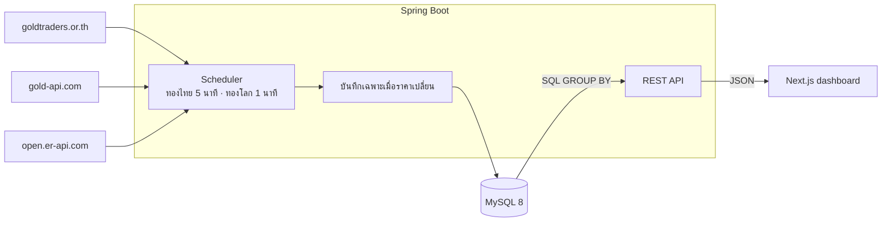

# GoldWatch

[](https://github.com/nazhan0-dev/Gold-Watch/actions/workflows/ci.yml?query=branch%3Amain)

เว็บติดตาม **ราคาทองคำไทย** (ทองคำแท่ง / ทองรูปพรรณ 96.5%) และ **ราคาทองโลก** (XAU/USD) พร้อมค่าเงินบาท
แบบใกล้เรียลไทม์ มี dashboard และกราฟย้อนหลัง เปิดดูได้ทันทีโดยไม่ต้องสมัครสมาชิก

> โปรเจกต์ฝึกงาน — Java Spring Boot + MySQL + Next.js

## วัตถุประสงค์

**ปัญหา:** ราคาทองไทยประกาศหลายรอบต่อวันและกระจายอยู่หลายเว็บ ส่วนราคาทองโลกกับค่าเงินบาทอยู่คนละที่
คนที่อยากรู้ว่า "ตอนนี้ทองราคาเท่าไร ขึ้นหรือลงจากเมื่อวาน และช่วงที่ผ่านมาเป็นอย่างไร" ต้องเปิดหลายเว็บ
และเว็บส่วนใหญ่ไม่เก็บประวัติให้ย้อนดู

**GoldWatch จึงทำหน้าที่:**

1. **รวมราคาไว้ในหน้าเดียว** — ทองคำแท่ง ทองรูปพรรณ ทองโลก และ USD/THB
2. **เก็บประวัติให้อัตโนมัติ** — ดึงราคาจากแหล่งข้อมูลตามรอบเวลาแล้วบันทึกลงฐานข้อมูล ทำให้ดูกราฟย้อนหลังได้
3. **บอกทิศทางราคาให้เข้าใจง่าย** — เทียบกับราคาปิดเมื่อวาน, การเปลี่ยนแปลงต่อรอบประกาศ, สูงสุด/ต่ำสุดในช่วงที่เลือก

**ในฐานะโปรเจกต์ฝึกงาน** ใช้ฝึกการทำระบบครบวงจร: ดึงข้อมูลจากภายนอกอย่างปลอดภัย (API และ scrape HTML),
ออกแบบฐานข้อมูล, รวมข้อมูลด้วย SQL, ทำ REST API, ทำหน้าเว็บ responsive, เขียน test และ CI

## ฟีเจอร์

- ราคาล่าสุด 4 ประเภท พร้อมการเปลี่ยนแปลงเทียบราคาปิดเมื่อวาน
- กราฟย้อนหลัง 1 วัน (รายชั่วโมง), 1 สัปดาห์ / 1 เดือน (รายวัน), 1 ปี (รายสัปดาห์) พร้อมสูงสุด / ต่ำสุด / เปลี่ยนแปลง
- ตารางรอบประกาศราคาทองไทยของวัน เรียงล่าสุดก่อน พร้อมการเปลี่ยนแปลงต่อรอบ
- หน้าเว็บอัปเดตเองทุก 60 วินาที ถ้า API ล่มยังแสดงราคาล่าสุดที่มีพร้อมข้อความแจ้งเตือน
- ธีมมืด / สว่าง, responsive ทั้งคอมและมือถือ
- Accessibility: ขึ้น/ลงแสดงด้วย ▲/▼ และ +/− ไม่ใช่สีอย่างเดียว, มี skip link, รองรับ "ลดการเคลื่อนไหว"

## สถาปัตยกรรม



- แต่ละแหล่งข้อมูลเป็น `PriceSource` แยกกัน — แหล่งหนึ่งล้มเหลว แหล่งอื่นยังทำงานต่อ และไม่มีข้อมูลผิดหรือว่างลงฐานข้อมูล
- ราคาเก็บเป็น `DECIMAL` / `BigDecimal` เสมอ, เวลาเก็บเป็น UTC และแปลงเป็นเวลาไทยตอนแสดงผล
- การรวมข้อมูลเป็นช่วงเวลาทำใน MySQL ไม่ดึงทั้งตารางมาประมวลผลในหน่วยความจำ

## Tech stack

| ส่วน | เครื่องมือ |
| --- | --- |
| Backend | Java 21, Spring Boot 4 (Web MVC, Data JPA, Cache, Actuator, `@Scheduled`), Maven |
| ดึงข้อมูล | `RestClient` (timeout + User-Agent), Jsoup |
| Database | MySQL 8 + Flyway |
| Frontend | Next.js 16 (App Router, TypeScript), React 19, Recharts, CSS Modules |
| Test | JUnit 5, Mockito, Testcontainers (MySQL), Jest + React Testing Library |
| Dev / CI | Docker Compose, GitHub Actions |

## วิธีรัน

> Deploy ขึ้นออนไลน์ฟรี (Vercel + Render + TiDB Cloud): ดู [DEPLOY.md](DEPLOY.md)

### แบบ Docker (แนะนำ)

ต้องมี Docker Desktop

```bash
cp .env.example .env        # แก้รหัสผ่านใน .env
docker compose up --build
```

เปิด <http://localhost:3000> (API อยู่ที่ <http://localhost:8080/api/prices/latest>)

### แบบไม่ใช้ Docker

ต้องมี Java 21+, Node.js 20.9+ และ MySQL 8 ที่มีฐานข้อมูล `goldtracker` กับผู้ใช้ `goldtracker`

1. สร้างไฟล์ `backend/application-local.yml` (ไฟล์นี้อยู่ใน `.gitignore` จะไม่ถูก commit):

   ```yaml
   spring:
     datasource:
       password: รหัสผ่านฐานข้อมูลของคุณ
   ```

2. รัน backend และ frontend คนละหน้าต่าง:

   ```bash
   cd backend && ./mvnw spring-boot:run        # Windows: .\mvnw.cmd spring-boot:run
   cd frontend && npm install && npm run dev
   ```

ตารางฐานข้อมูลสร้างให้อัตโนมัติด้วย Flyway กราฟจะเริ่มมีข้อมูลหลังระบบรันไปสักพัก

### Environment variables หลัก

| ตัวแปร | ค่าเริ่มต้น | ความหมาย |
| --- | --- | --- |
| `DB_URL`, `DB_USERNAME`, `DB_PASSWORD` | localhost:3306 / `goldtracker` / – | การเชื่อมต่อ MySQL |
| `SCHEDULER_INTERVAL` | `PT5M` | ความถี่ดึงราคาทองไทย (ไม่ควรถี่กว่า `PT2M`) |
| `SPOT_SCHEDULER_INTERVAL` | `PT1M` | ความถี่ดึงราคาทองโลก |
| `CORS_ALLOWED_ORIGINS` | `http://localhost:3000` | origin ที่เรียก API ได้ |
| `NEXT_PUBLIC_API_BASE_URL` | `http://localhost:8080` | URL ที่เบราว์เซอร์ใช้เรียก API (ฝังตอน build) |

## Test

```bash
cd backend && ./mvnw verify     # unit + integration test กับ MySQL จริง (Testcontainers ต้องมี Docker)

cd frontend
npm test                        # Jest
npm run lint && npm run typecheck && npm run build
```

ถ้าไม่มี Docker, integration test จะถูกข้ามอัตโนมัติ หรือชี้ไป MySQL ที่มีอยู่แทนได้ด้วย
`-Dit.mysql.url=jdbc:mysql://127.0.0.1:3306/<db>?connectionTimeZone=UTC&forceConnectionTimeZoneToSession=true -Dit.mysql.username=... -Dit.mysql.password=...`

GitHub Actions รันทั้งหมดนี้ทุก push / pull request และทดสอบ `docker compose up` ด้วย

## API

ทุก endpoint เป็น `GET` ตอบ JSON, เวลาเป็น ISO 8601 (UTC), ราคาเป็น string ทศนิยมเพื่อไม่เสียความแม่นยำ

| Endpoint | คำอธิบาย |
| --- | --- |
| `/api/prices/latest` | ราคาล่าสุดของ `bar`, `ornament`, `spot`, `usdThb` พร้อม `change` / `changePercent` เทียบราคาปิดเมื่อวาน |
| `/api/prices/history?type=bar\|ornament\|spot&range=1D\|1W\|1M\|1Y` | ราคาย้อนหลังรวมเป็นช่วง (open/high/low/close) + สรุปสูงสุด/ต่ำสุด/เปลี่ยนแปลง |
| `/api/prices/announcements?date=YYYY-MM-DD` | รอบประกาศราคาทองไทยของวันนั้น (ไม่ใส่ = วันนี้) เรียงล่าสุดก่อน |

ค่าพารามิเตอร์ผิดตอบ `400` เป็น JSON ที่อ่านเข้าใจ เช่น `"Unknown range '5Y'. Allowed values: 1D, 1W, 1M, 1Y"`

## แหล่งข้อมูลและข้อจำกัด

| ข้อมูล | แหล่ง | หมายเหตุ |
| --- | --- | --- |
| ทองคำแท่ง / ทองรูปพรรณ 96.5% | [สมาคมค้าทองคำ](https://www.goldtraders.or.th/) | อ่านจาก HTML หน้าแรกตามที่ robots.txt อนุญาต (ไม่เรียก `/api/`) |
| XAU/USD | [gold-api.com](https://gold-api.com/) | ฟรี ไม่ใช้ key |
| USD/THB | [Rates By Exchange Rate API](https://www.exchangerate-api.com) | ฟรี ไม่ใช้ key อัปเดตวันละครั้ง |

- ถ้าเว็บสมาคมเปลี่ยนโครงสร้างหน้า ระบบจะ log error และหยุดบันทึกราคาทองไทยจนกว่าจะแก้ parser
- ทองรูปพรรณ: เว็บสมาคมแสดง "ฐานภาษี" แทนราคารับซื้อ ระบบใช้ค่านี้เป็นราคารับซื้อตามที่สื่อทั่วไปรายงาน
- มีประวัติเฉพาะช่วงที่ระบบรันอยู่ (ไม่มีข้อมูลย้อนหลังก่อนเริ่มใช้งาน)

ภาพบนการ์ดราคามาจาก Wikimedia Commons — เครดิตและสัญญาอนุญาตอยู่ใน
[`frontend/src/assets/prices/CREDITS.md`](frontend/src/assets/prices/CREDITS.md)

## Disclaimer

ข้อมูลบนเว็บไซต์นี้ใช้เพื่อการติดตามราคาเท่านั้น ไม่ใช่คำแนะนำการลงทุน
โปรเจกต์นี้ไม่มีส่วนเกี่ยวข้องกับสมาคมค้าทองคำหรือผู้ให้บริการข้อมูลข้างต้น
