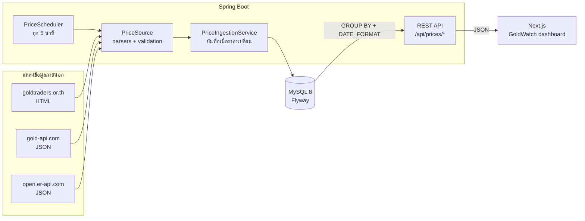

# GoldWatch — Gold Price Tracker

[](https://github.com/<your-github-username>/gold-price-tracker/actions/workflows/ci.yml)

เว็บติดตาม **ราคาทองคำไทย** (ทองคำแท่ง / ทองรูปพรรณ 96.5%) และ **ราคาทองโลก** (XAU/USD) พร้อมค่าเงินบาท
แบบใกล้เรียลไทม์ มี dashboard และกราฟย้อนหลังรายชั่วโมง / วัน / สัปดาห์ เปิดดูได้ทันทีโดยไม่ต้องสมัครสมาชิก

> โปรเจกต์ฝึกงาน — Spring Boot + MySQL + Next.js

## ปัญหาที่แก้

ราคาทองไทยประกาศหลายรอบต่อวัน และกระจายอยู่หลายเว็บ ราคาทองโลกกับค่าเงินบาทก็อยู่คนละที่
GoldWatch เก็บราคาจากแหล่งข้อมูลอัตโนมัติทุก 5 นาที เก็บประวัติลงฐานข้อมูล และแสดงทุกอย่างในหน้าเดียว

## ฟีเจอร์

- ราคาล่าสุดของทองคำแท่ง ทองรูปพรรณ ทองโลก และ USD/THB พร้อมการเปลี่ยนแปลงเทียบราคาปิดเมื่อวาน
- กราฟย้อนหลัง 1 วัน (รายชั่วโมง), 1 สัปดาห์ / 1 เดือน (รายวัน), 1 ปี (รายสัปดาห์) พร้อมสูงสุด / ต่ำสุด / เปลี่ยนแปลง
- ประวัติรอบประกาศของวัน พร้อมการเปลี่ยนแปลงต่อรอบ
- รีเฟรชอัตโนมัติทุก 60 วินาที ถ้า API ล่มยังแสดงราคาล่าสุดที่มีพร้อมข้อความแจ้งเตือน
- Responsive ทั้งคอมและมือถือ, ขึ้น/ลงแสดงด้วย ▲/▼ และ +/− ไม่ใช่สีอย่างเดียว

## ภาพหน้าจอ

| Desktop | Mobile |
| --- | --- |
|  |  |

<!-- TODO: วางภาพจริงที่ docs/screenshots/desktop.png และ docs/screenshots/mobile.png -->

## สถาปัตยกรรม



**Scheduler → MySQL → REST API → Next.js**

- `source/` — `PriceSource<T>` interface; แต่ละแหล่งข้อมูลเป็น implementation แยก (สลับ/เพิ่มแหล่งได้ที่จุดเดียว)
- `scheduler/` — ดึงแต่ละแหล่งแยกกัน แหล่งหนึ่งล้มเหลว แหล่งอื่นยังทำงานต่อ และไม่มีข้อมูลผิดลง DB
- `service/` — บันทึกเฉพาะเมื่อรอบประกาศ/ราคาเปลี่ยน, query สำหรับ API
- `repository/` — JPA + SQL รวมข้อมูลเป็นช่วงเวลาใน MySQL (ไม่ดึงทั้งตารางมาประมวลผลในหน่วยความจำ)
- `api/` — REST controllers, DTO, error JSON (RFC 9457)

ราคาเก็บเป็น `DECIMAL` / `BigDecimal` เสมอ, เวลาเก็บเป็น UTC และแปลงเป็นเวลาไทยตอนแสดงผล

## Tech stack

| ส่วน | เครื่องมือ |
| --- | --- |
| Backend | Java 21, Spring Boot 4 (Web MVC, Data JPA, Validation, Cache, `@Scheduled`), Maven |
| ดึงข้อมูล | `RestClient` (timeout + User-Agent), Jsoup |
| Database | MySQL 8 + Flyway |
| Frontend | Next.js 16 (App Router, TypeScript), Recharts, CSS Modules + design tokens |
| Test | JUnit 5, Mockito, Testcontainers (MySQL), Jest + React Testing Library |
| Dev / CI | Docker Compose, GitHub Actions |

## วิธีรัน

ต้องมี Docker Desktop (หรือ Docker Engine + Compose v2)

```bash
cp .env.example .env      # แก้รหัสผ่านใน .env ก่อนใช้งานจริง
docker compose up --build
```

- เว็บ: <http://localhost:3000>
- API: <http://localhost:8080/api/prices/latest>
- Health: <http://localhost:8080/actuator/health>

ข้อมูลกราฟจะเริ่มสะสมหลังระบบรันไปสักพัก (ดึงราคาทุก 5 นาที)

### รันแยกส่วนสำหรับพัฒนา

```bash
# Backend (ต้องมี MySQL ที่ localhost:3306 หรือกำหนด DB_URL / DB_USERNAME / DB_PASSWORD)
cd backend && ./mvnw spring-boot:run

# Frontend
cd frontend && npm install && npm run dev
```

### Test

```bash
cd backend && ./mvnw verify          # unit + integration (Testcontainers ต้องมี Docker)
cd frontend && npm test               # Jest
```

ถ้าเครื่องไม่มี Docker, integration test จะถูกข้ามอัตโนมัติ หรือชี้ไปที่ MySQL ที่มีอยู่ได้:

```bash
./mvnw verify "-Dit.mysql.url=jdbc:mysql://127.0.0.1:3306/goldtracker_it?connectionTimeZone=UTC&forceConnectionTimeZoneToSession=true" \
  -Dit.mysql.username=root -Dit.mysql.password=...
```

### Environment variables

ดู `.env.example` — ค่าที่สำคัญ: `MYSQL_*`, `CORS_ALLOWED_ORIGINS` (ค่าเริ่มต้น `http://localhost:3000`),
`SCHEDULER_INTERVAL` (ISO-8601 เช่น `PT5M`), `NEXT_PUBLIC_API_BASE_URL` (URL ที่ **เบราว์เซอร์** ใช้เรียก API, ฝังตอน build)

## API

ทุก endpoint เป็น `GET`, ตอบ JSON, เวลาเป็น ISO 8601 (UTC), ราคาเป็น **string ทศนิยม** เพื่อไม่เสียความแม่นยำ

| Endpoint | คำอธิบาย |
| --- | --- |
| `GET /api/prices/latest` | ราคาล่าสุดของ `bar`, `ornament`, `spot`, `usdThb` + `previousClose`, `change`, `changePercent` (เทียบราคาสุดท้ายของวันก่อนตามเวลาไทย), `updatedAt` · cache 30 วินาที |
| `GET /api/prices/history?type=bar\|ornament\|spot&range=1D\|1W\|1M\|1Y` | ราคาย้อนหลังรวมเป็นช่วง: 1D รายชั่วโมง, 1W/1M รายวัน, 1Y รายสัปดาห์ (เริ่มวันจันทร์) แต่ละจุดมี `open/high/low/close` (close = ราคาสุดท้ายของช่วง) + `stats` ของทั้งช่วง ทองไทยใช้ราคาขายออก |
| `GET /api/prices/announcements?date=YYYY-MM-DD` | รอบประกาศราคาทองไทยของวันนั้น (ไม่ใส่ = วันนี้ตามเวลาไทย) เรียงล่าสุดก่อน พร้อม `change` ราคาขายทองแท่งเทียบรอบก่อน |

ตัวอย่าง

```http
GET /api/prices/latest
```

```json
{
  "bar": { "buy": "56950.00", "sell": "57150.00", "previousClose": "57000.00",
           "change": "150.00", "changePercent": "0.26", "updatedAt": "2026-11-22T02:09:00Z" },
  "ornament": { "buy": "55803.96", "sell": "57950.00", "...": "..." },
  "spot": { "price": "3539.0000", "unit": "USD", "...": "..." },
  "usdThb": { "price": "33.9184", "unit": "THB", "...": "..." },
  "updatedAt": "2026-11-22T07:17:39Z"
}
```

ค่าพารามิเตอร์ผิดตอบ `400` เป็น problem JSON:

```json
{ "status": 400, "title": "Invalid parameter", "parameter": "range",
  "detail": "Unknown range '5Y'. Allowed values: 1D, 1W, 1M, 1Y" }
```

## แหล่งข้อมูลและข้อจำกัด

| ข้อมูล | แหล่ง | หมายเหตุ |
| --- | --- | --- |
| ทองคำแท่ง / ทองรูปพรรณ 96.5% | [สมาคมค้าทองคำ](https://www.goldtraders.or.th/) | อ่านจาก HTML หน้าแรก (robots.txt อนุญาต `/` และห้าม `/api/` จึงไม่เรียก `/api/`) ดึงไม่เกินทุก 5 นาที |
| XAU/USD | [gold-api.com](https://gold-api.com/) | ฟรี ไม่ใช้ key |
| USD/THB | [Rates By Exchange Rate API](https://www.exchangerate-api.com) (`open.er-api.com`) | ฟรี ไม่ใช้ key **อัปเดตวันละครั้ง** ระบบเรียกไม่เกินชั่วโมงละครั้ง |

- **โครงสร้างเว็บสมาคมอาจเปลี่ยน** parser อาศัยข้อความภาษาไทยที่มองเห็นบนหน้า (`ทองคำแท่ง`, `รับซื้อ`, `ขายออก`, `ประจำวันที่ … (ครั้งที่ N)`)
  ไม่ใช่ CSS class ถ้าหาไม่เจอจะ log error และไม่บันทึกอะไร — ตรวจ log ถ้าราคาไม่อัปเดต
- ทองรูปพรรณ: เว็บสมาคมแสดงช่อง **"ฐานภาษี"** แทนราคารับซื้อ ระบบเก็บค่านี้เป็น `buy` ตามที่สื่อทั่วไปรายงานเป็นราคารับซื้อทองรูปพรรณ
- ราคาล่าช้าจากต้นทางได้สูงสุดประมาณ 1 รอบ scheduler (5 นาที) และรอบประกาศที่เกิดและถูกแทนที่ภายใน 5 นาทีอาจไม่ถูกเก็บ
- ประวัติมีเฉพาะช่วงที่ระบบรันอยู่ (ไม่มีการนำเข้าข้อมูลย้อนหลัง)
- `usd_thb` เป็น `NULL` ได้ถ้ายังไม่เคยดึงอัตราแลกเปลี่ยนสำเร็จ หรืออัตราที่มีเก่ากว่า 48 ชั่วโมง

## Disclaimer

ข้อมูลบนเว็บไซต์นี้ใช้เพื่อการติดตามราคาเท่านั้น ไม่ใช่คำแนะนำการลงทุน
ข้อมูลเป็นของเจ้าของแหล่งข้อมูลแต่ละราย โปรเจกต์นี้ไม่มีส่วนเกี่ยวข้องกับสมาคมค้าทองคำหรือผู้ให้บริการข้อมูลข้างต้น
